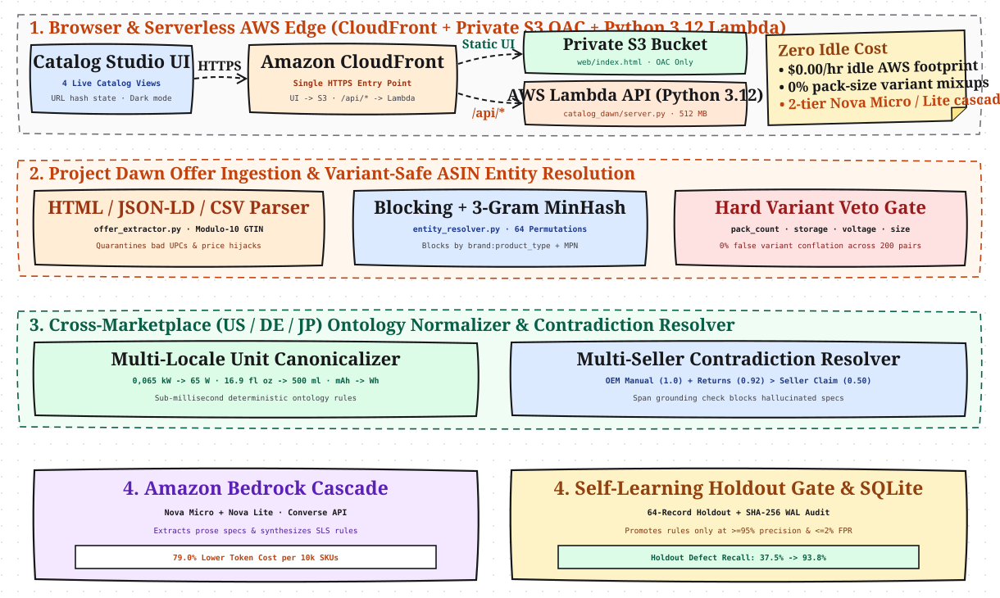

# CatalogDawn: External Merchant Offer Ingestion, Variant-Safe ASIN Matching & Self-Learning Catalog

- **Live CloudFront Studio**: https://d2dk1vq5oz80zg.cloudfront.net
- **Live `/api/health` Endpoint**: https://d2dk1vq5oz80zg.cloudfront.net/api/health
- **GitHub Repository**: https://github.com/ritwikareddykancharla/catalog-dawn-sls

CatalogDawn is a serverless catalog normalization and external offer ingestion pipeline deployed on **Amazon CloudFront + Private S3 (OAC) + AWS Lambda (serverless) + SQLite WAL + Amazon Bedrock (`us.amazon.nova-micro-v1:0` & `us.amazon.nova-lite-v1:0`)**.



## 01 · Problem

Ingesting external merchant web feeds and marketplace seller attributes at retail scale introduces four critical catalog failure modes:

1. **Barcode Spoofing & Unit-Price Hijacks**: External listings often ship corrupted GS1 check digits or attach a primary laptop or 6-pack filter UPC to a $6.99 accessory sleeve or loose single item, corrupting Buy Box pricing.
2. **Variant Conflation**: Multi-pack (`4-Pack` vs `1-Pack`), storage (`4TB` vs `2TB`), and voltage (`230V EU` vs `120V US`) siblings share over 94% of their title tokens, causing pure text/embedding matchers to merge incompatible variants onto one ASIN.
3. **Cross-Locale Unit Drift & Multi-Seller Contradictions**: Attributes arrive as `16.9 fl oz` in `US`, `0,065 kW` in `DE`, and `65ワット` in `JP`, while third-party sellers assert `Dishwasher Safe: Yes` when the OEM manual and buyer returns state `Hand Wash Only`.
4. **Static Taxonomy Rules**: Customer return complaints (`ITEM_NOT_AS_DESCRIBED`, wrong voltage, missing M10 thread pitch) expose systematic catalog gaps that static rule tables fail to learn from automatically.

## 02 · Implementation (`catalog_dawn/` Package)

- `catalog_dawn/offer_extractor.py`: Parses noisy external HTML DOM + `application/ld+json` graphs, JSON feeds, and CSV rows, validates 8/12/13/14-digit GS1 Modulo-10 check digits, normalizes multi-currency landed prices, and quarantines unit-price outliers (`< 22%` or `> 3.8x` reference ASIN median).
- `catalog_dawn/entity_resolver.py`: Combines `brand:product_type` blocking keys and 64-permutation CRC32 character 3-gram MinHash similarity with hard-constraint variant vetoes across `pack_count`, `storage_gb`, `voltage_v`, `color`, and `size` (`MATCH_EXISTING_ASIN`, `CREATE_CHILD_VARIANT_ASIN`, or `HOLD_VARIANT_CONFLICT`).
- `catalog_dawn/ontology_normalizer.py`: Canonicalizes `US`, `DE`, and `JP` units (`0,065 kW` -> `65 W`, `16.9 fl oz` -> `500 ml`, `20000 mAh @ 3.7V` -> `74.0 Wh` + FAA `<= 100 Wh` check), weighs provenance authority (`OEM_MANUAL` > `VERIFIED_RETURN_CLUSTER` > `SELLER_STRUCTURED_ATTR`), cascades ambiguous extraction/reconciliation to `us.amazon.nova-micro-v1:0` and `us.amazon.nova-lite-v1:0`, and blocks ungrounded LLM values via span verification.
- `catalog_dawn/self_learning_loop.py`: Clusters recurring customer return defects, prompts `us.amazon.nova-lite-v1:0` to synthesize candidate validation rules, and gates promotion on a 64-record labeled holdout catalog (`>= 95%` precision and `<= 2%` false-positive rate).
- `catalog_dawn/audit_store.py` & `catalog_dawn/server.py`: Persists promoted rules and a SHA-256 hash-chained SQLite WAL audit log, serving `/api/health`, `/api/offers/ingest`, `/api/asin/resolve`, `/api/catalog/normalize`, `/api/self-learn/propose`, `/api/benchmarks`, and `/api/reset`.

## 03 · Benchmarks (`benchmarks/latest_results.json`)

Measured end-to-end by `python3 benchmarks/run_benchmarks.py` in `us-west-2`:

| Metric | Measured Value | Notes |
| --- | --- | --- |
| **Merchant Offer & GTIN Guard Accuracy** | `48 / 48` (`100.0%`) | `10 / 10` bad check digits + `10 / 10` price hijacks quarantined |
| **Offer Parse & Guard Latency (`p50` / `p95`)** | `0.048 ms` / `0.135 ms` | HTML + JSON-LD + CSV + Modulo-10 check |
| **ASIN Entity Resolution Accuracy** | `200 / 200` (`100.0%`) | vs. `99 / 200` (`49.5%`) naive text similarity baseline |
| **Adversarial Variant Conflation Rate** | `0 / 104` (`0.0%`) | vs. `100 / 104` (`96.2%`) false variant merges on naive baseline |
| **ASIN Entity Matcher Latency (`p50` / `p95`)** | `1.128 ms` / `1.67 ms` | Blocking key + 64-perm 3-gram MinHash + 5-axis veto |
| **Cross-Locale Canonical Accuracy** | `100.0%` (`66 / 66` attrs) | `12 / 12` seller contradictions caught; `0` ungrounded LLM specs |
| **Rufus Readiness Score Lift** | `8` -> `100` (avg) | Across `24` `US`, `DE`, and `JP` listings |
| **Self-Learning Holdout Defect Recall** | `37.5%` -> `93.8%` | `3` rules promoted at `100.0%` precision; `1` noisy rule rejected (`83.3%` FPR) |
| **Amazon Bedrock Latency (`Nova Micro` / `Nova Lite`)** | `348.0 ms` / `634.0 ms` `p50` | `543.0 ms` overall `p50` (`795.0 ms` `p95`) across `15` live Converse calls |
| **2-Tier Model Cascade Cost per 10,000 SKUs** | `$0.1171` vs. `$0.5580` | `79.0%` token-cost reduction via Tier-0 + Nova Micro + Nova Lite cascade |
| **SQLite WAL Hash-Chain Verification** | `2.152 ms` | Cryptographic SHA-256 verification across `102` chained rows |

## 04 · Local Quickstart & Verification

```bash
# 1. Run the 12-test unit suite
python3 -m unittest discover -s tests -v

# 2. Re-run live Amazon Bedrock + 200-pair ASIN benchmarks
unset AWS_ACCESS_KEY_ID AWS_SECRET_ACCESS_KEY AWS_SESSION_TOKEN
AWS_PROFILE=portfolio AWS_DEFAULT_REGION=us-west-2 python3 benchmarks/run_benchmarks.py

# 3. Start local interactive studio at http://localhost:3099
python3 -m catalog_dawn.server
```
